#Tarea 5.2
**1\. Creamos la primera red denominada “Red1”:**  

```bash
docker network create --driver bridge --subnet 172.28.0.0/16 --gateway 172.28.0.1 red1
```

****  

**Esto crea la red con los siguientes datos:**

* **Nombre: redil**  
* **Driver: bridge**  
* **Dirección de red: 172.28.0.0**  
* **Máscara: 255.255.0.0**  
* **Gateway: 172.28.0.1**

**2\. Procedemos a crear la segunda red la cual denominaremos “Red2”:**  

```bash
docker network create --driver bridge red2
```

**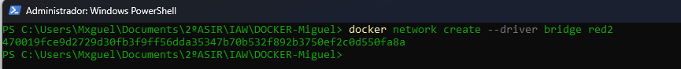**  

**3\. Comprobamos que efectivamente se han creado:**  

```bash
docker network ls
```

**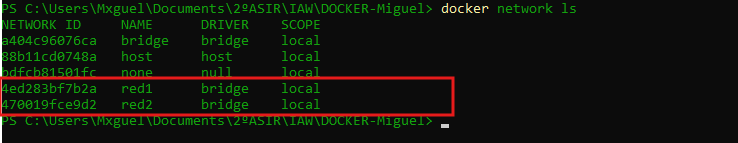**  

**4\. Inspeccionamos la red 1 y vemos la configuración que establecimos:**  

```bash
docker network inspect red1
```

**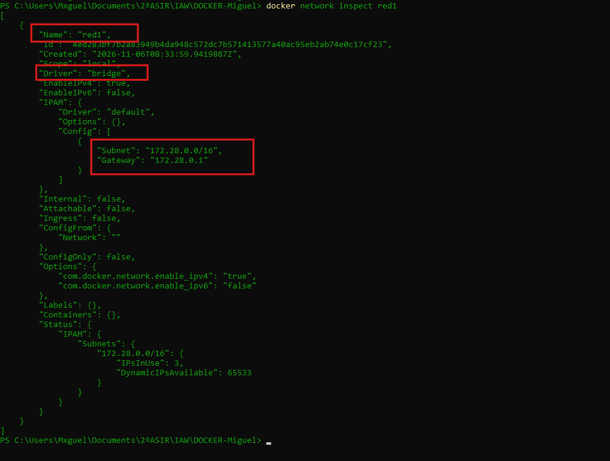**  

**5\. Inspeccionamos la red 2 y vemos la configuración asignada por defecto:**  

```bash
docker network inspect red2
```

**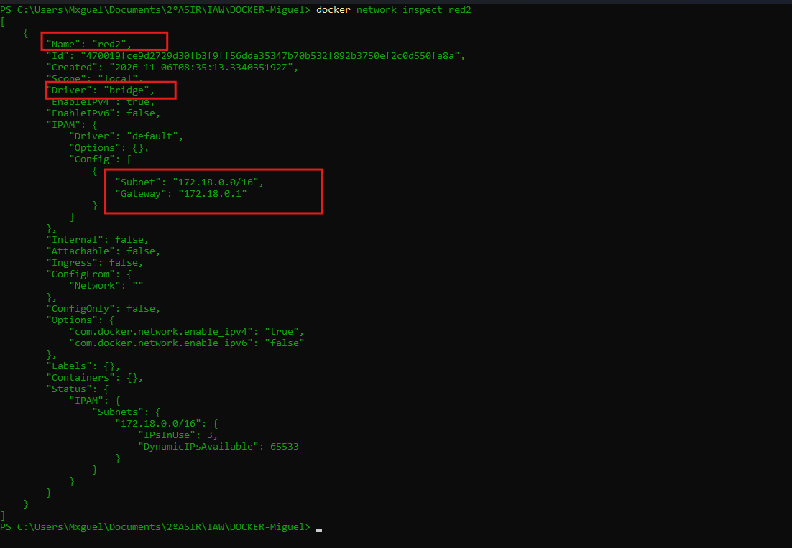**  

**Tarea 5.2**  

**1\. Comenzamos creando un contenedor (u1) poniendo en ejecución un contenedor de la imagen ubuntu:20.04:**  

```bash
docker run -dit --name u1 --hostname host1 --network red1 --ip 172.28.0.10 ubuntu:20.04
```

**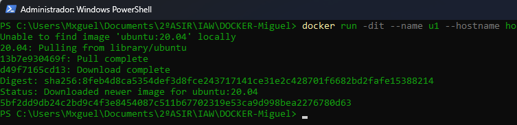**

**2\. Instalamos ping en el contenedor u1:**  

**1º Lo ejecutamos:**

```bash
docker exec -it u1 bash
```

**2º Instalamos ping:**

```bash
apt update && apt install inetutils-ping -y
```

**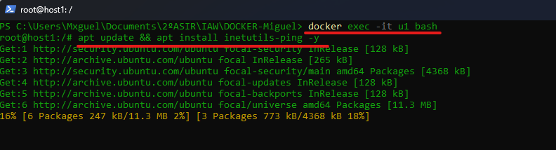**  

**3º Comprobamos la configuración de red y el nombre de host:**

```bash
hostname
```

**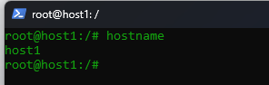**  

```bash
ip addr show
```

**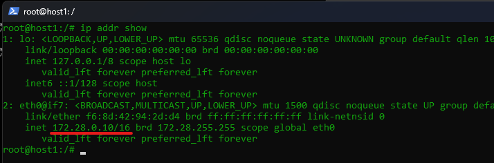**  

**3\. Creamos el segundo contenedor (u2)**

```bash
docker run -dit --name u2 --hostname host2 --network red2 ubuntu:20.04
```

**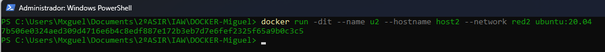**  

**4\. Instalamos ping en u2:**  

**1º Lo ejecutamos:**

```bash
docker exec -it u2 bash
```

**2º Instalamos ping:**

```bash
apt update && apt install inetutils-ping -y
```

**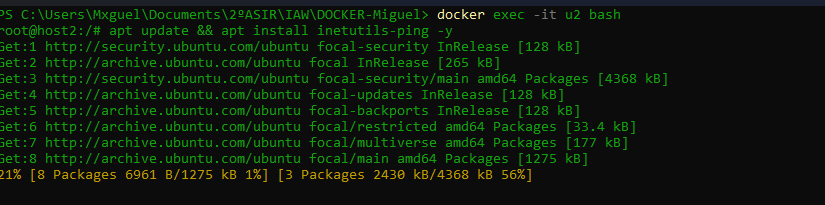**  

**3º Comprobamos la configuración de red y el nombre de host:**

```bash
hostname
```

**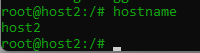**  

```bash
ip addr show
```

**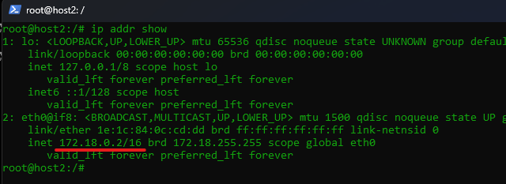**  

**5\. Intentamos los pings**  

**Por nombre de host:**

```bash
ping host1
```

**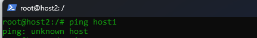**  

```bash
ping host2
```

**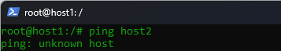**  

**Por IP:**

```bash
ping 172.18.0.10 (IP u1)
```

**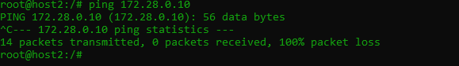**  

```bash
ping 172.18.0.2 (IP u2)
```

**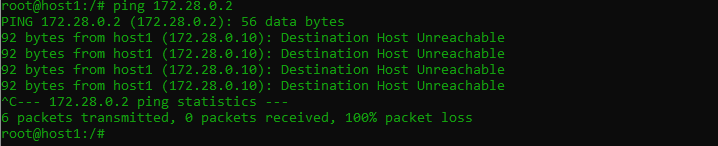**  

**6\. Conectar u1 a la red2:**

```bash
docker network connect red2 u1
```

****  

**7\. Comprobamos que ahora sí se ven:**  

**1º**

```bash
docker exec -it u1 bash
```

**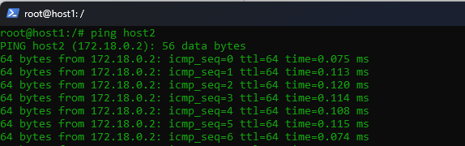**  

**2º**

```bash
ping 172.18.0.2 (IP u2)
```

**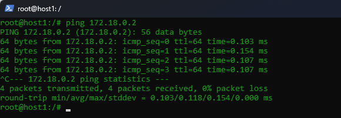**
