# Tarea módulo 2: Ejecutando y gestionando contenedores

## 1. Instalación de imágenes

Instalamos los siguientes servicios mediante el comando `docker pull`:

    docker pull ubuntu:18.04

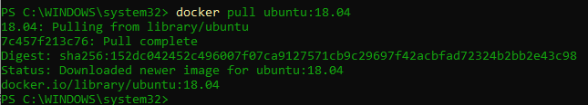

    docker pull centos:8

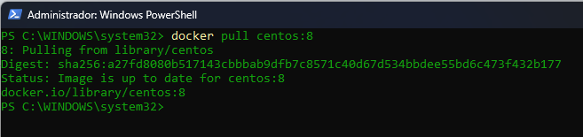

    docker pull debian:9

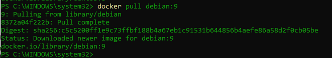

    docker pull mariadb:latest

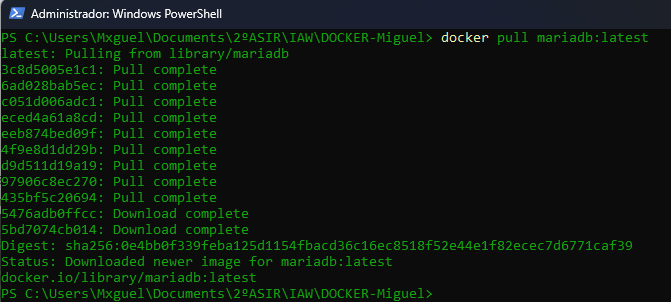

    docker pull mysql:5.7

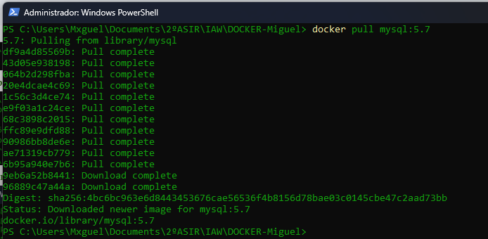

Ejecutamos `docker images` para comprobar que se han descargado correctamente:

    docker images

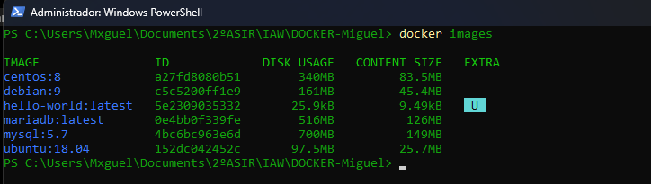

## 1.2. Arrancar un contenedor

### 1.2.1. Salir del contenedor y comprobar que se ha parado

    docker run -it --name ubuntu ubuntu:18.04

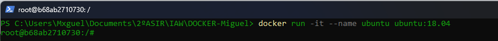

Dentro del contenedor, salimos con:

    exit

Comprobamos que el contenedor se ha parado:

    docker ps -a

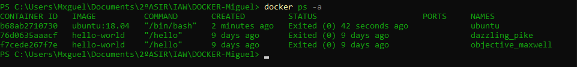

### 1.2.2. Rearrancar el contenedor desde el equipo

    docker start ubuntu

    docker ps

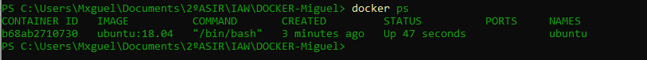

### 1.2.3. Mostrar `/etc/os-release` sin entrar en el contenedor

    docker exec ubuntu cat /etc/os-release

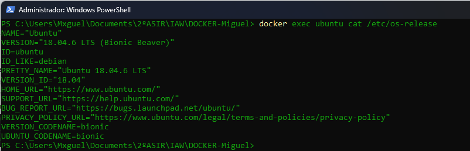

## 1.3. Ejecutando servicios desde contenedores

### 1.3.1. Arrancar un servidor web Apache con PHP

Arrancamos un contenedor llamado `web` con la imagen `php:7.3-apache`, accesible desde el equipo por el puerto `8181`.

    docker run -d --name web -p 8181:80 php:7.3-apache

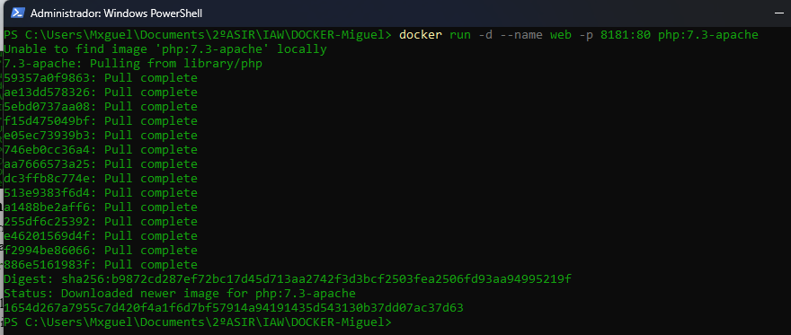

Comprobamos que está funcionando:

    docker ps

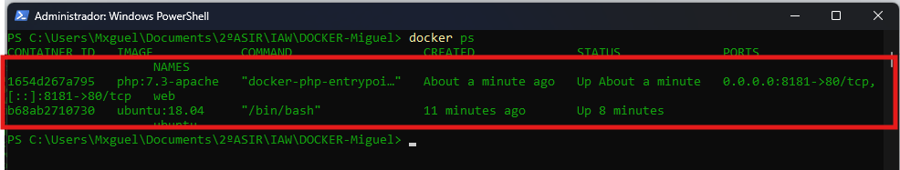

### 1.3.2. Copiar `index.html` al directorio raíz del servidor web

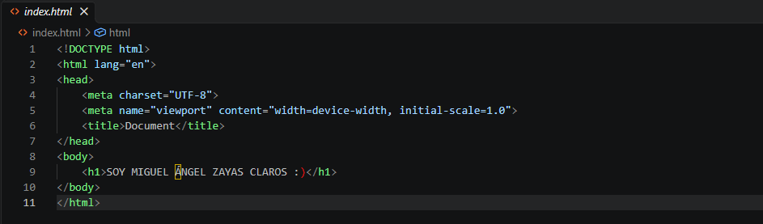

    docker cp index.html web:/var/www/html/index.html

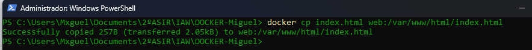

### 1.3.3. Copiar `index.php` al directorio raíz del servidor web
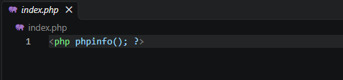

    docker cp index.php web:/var/www/html/index.php

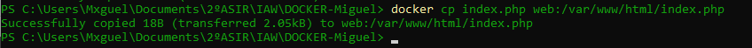

### 1.3.3.1 Probamos a entrar desde el navegador

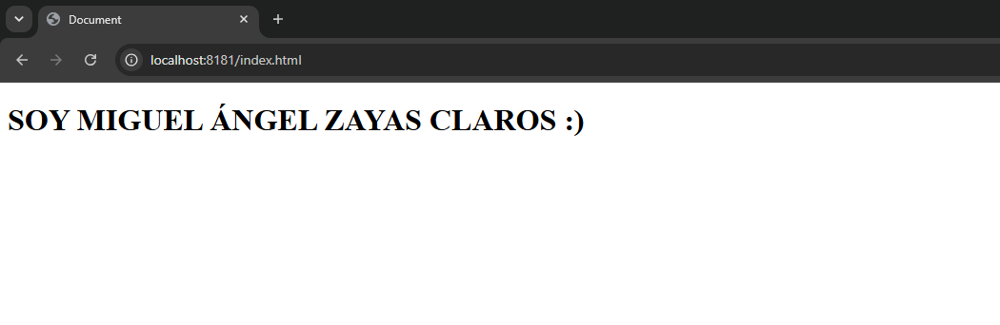
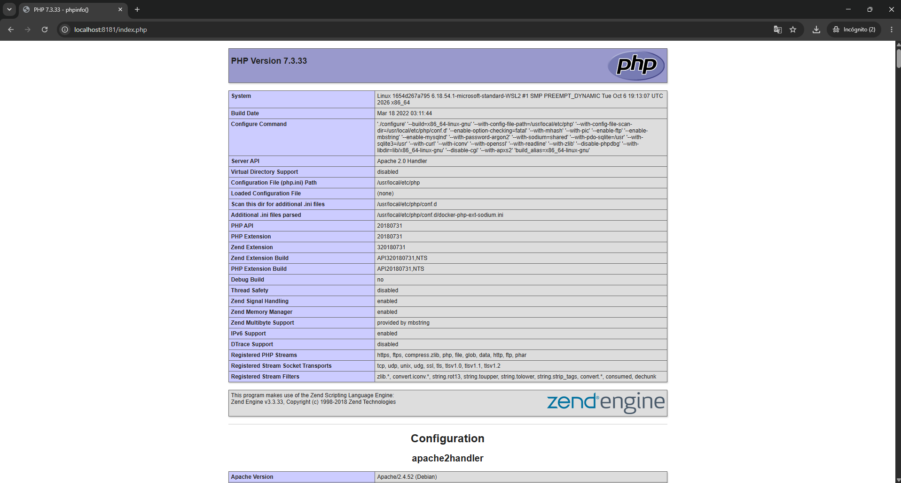

### 1.3.4. Arrancar una base de datos MariaDB

Arrancamos un contenedor llamado `bbdd` con la imagen `mariadb:latest`, accesible desde el puerto `3336`.

- Contraseña de `root`: `root`.
- Base de datos creada automáticamente: `prueba`.
- Usuario: `invitado`.
- Contraseña del usuario: `invitado`.

      docker run -d --name bbdd -p 3336:3306 -e MARIADB_ROOT_PASSWORD=root -e MARIADB_DATABASE=prueba
      -e MARIADB_USER=invitado -e MARIADB_PASSWORD=invitado mariadb:latest

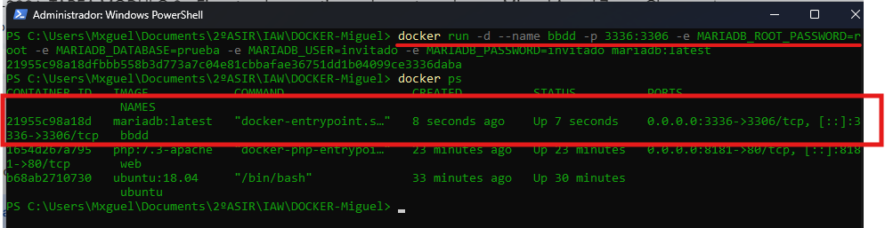

Probamos desde Docker primero:
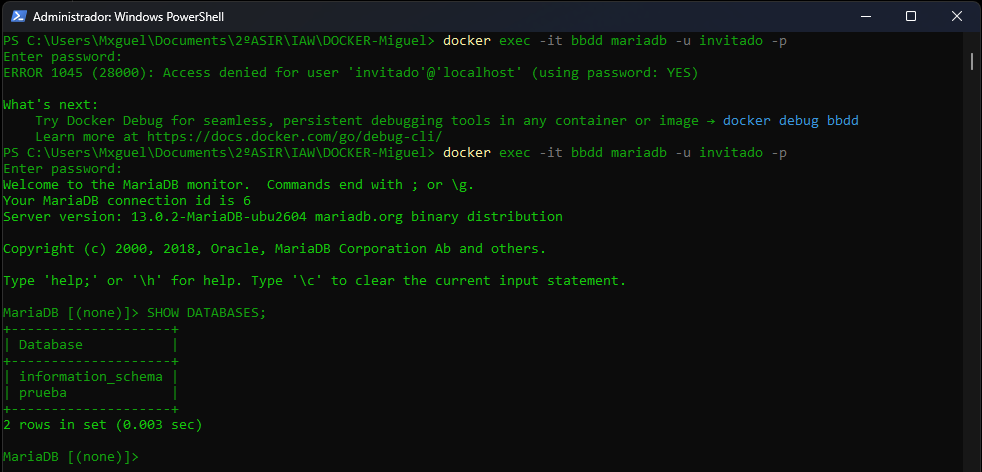

Entramos desde un cliente (DBeaver)
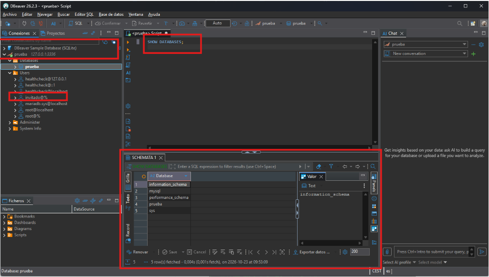

## 1.4. Obtener información de los contenedores

### Dirección IP del contenedor web

    docker inspect web | findstr "Ip"

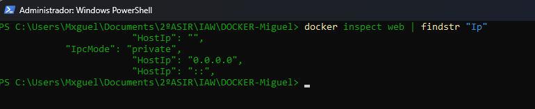

### Redirección de puertos del contenedor web

    docker port web

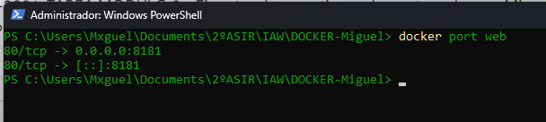

### Dirección IP del contenedor bbdd

    docker inspect bbdd | findstr "Ip"

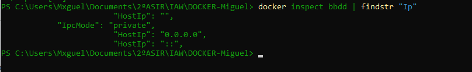

### Redirección de puertos del contenedor bbdd

    docker port bbdd

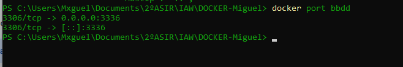
