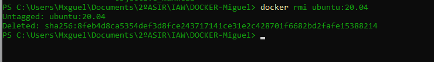
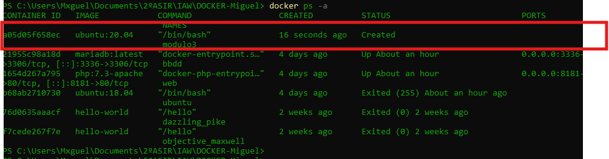
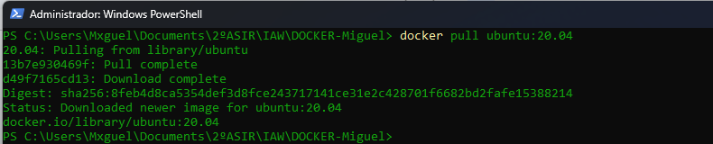
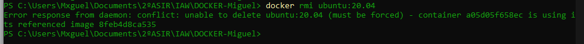
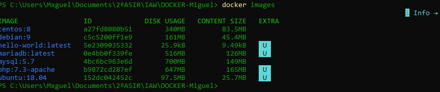

# Práctica 3. Gestión de imágenes y contenedores en Docker

## 1. Descargar la imagen de Ubuntu 20.04

En primer lugar, descargamos la imagen oficial de Ubuntu 20.04 desde Docker Hub mediante el siguiente comando:

```bash
docker pull ubuntu:20.04
```

**Figura 1.** Descarga de la imagen de Ubuntu 20.04.


Una vez finalizada la descarga, comprobamos que la imagen se encuentra disponible en nuestro sistema local:

```bash
docker images
```

**Figura 2.** Verificación de la imagen descargada.



## 2. Obtener la información de la imagen

Para consultar las características y la configuración de la imagen, utilizamos el comando `docker image inspect`. Redirigimos la salida a un archivo llamado `info.txt` para conservar toda la información obtenida.

```bash
docker image inspect ubuntu:20.04 > info.txt
```

A continuación, mostramos el contenido del archivo para comprobar que la información se ha guardado correctamente:

```bash
cat info.txt
```

**Figura 3.** Obtención y visualización de la información de la imagen.



## 3. Crear un contenedor llamado `modulo3`

A partir de la imagen descargada, creamos un contenedor con el nombre `modulo3` mediante el siguiente comando:

```bash
docker create --name modulo3 ubuntu:20.04
```

Este comando crea el contenedor, pero no lo inicia.

**Figura 4.** Creación del contenedor `modulo3`.



Para comprobar que el contenedor se ha creado correctamente, mostramos todos los contenedores del sistema, incluidos los que están detenidos:

```bash
docker ps -a
```

**Figura 5.** Verificación de la creación del contenedor.


## 4. Intentar eliminar la imagen de Ubuntu 20.04

Intentamos eliminar la imagen mediante el siguiente comando:

```bash
docker rmi ubuntu:20.04
```

**Figura 6.** Intento de eliminación de la imagen.



### Explicación del resultado

Docker puede impedir la eliminación de la imagen cuando existe un contenedor que depende de ella. En este caso, el contenedor `modulo3` utiliza la imagen `ubuntu:20.04`, por lo que es necesario eliminar primero el contenedor antes de borrar la imagen.

Aunque existe la opción `docker rmi -f ubuntu:20.04` para forzar determinadas operaciones, no es la alternativa recomendada para esta práctica.

La solución más adecuada consiste en eliminar primero el contenedor asociado y, posteriormente, eliminar la imagen. De este modo, se respeta el orden de dependencias entre los recursos de Docker.

## 5. Eliminar el contenedor y la imagen

Para completar la práctica, realizamos las operaciones necesarias para eliminar ambos recursos.

### 5.1. Comprobar el estado del contenedor

En primer lugar, consultamos el listado de contenedores para verificar el estado de `modulo3`:

```bash
docker ps -a
```

Si el contenedor estuviera en ejecución, sería necesario detenerlo antes de eliminarlo:

```bash
docker stop modulo3
```

**Figura 7.** Comprobación y, si procede, detención del contenedor.


### 5.2. Eliminar el contenedor

Una vez detenido, si fuera necesario, eliminamos el contenedor `modulo3`:

```bash
docker rm modulo3
```

A continuación, volvemos a consultar todos los contenedores para comprobar que se ha eliminado correctamente:

```bash
docker ps -a
```

**Figura 8.** Eliminación y comprobación del contenedor `modulo3`.


### 5.3. Eliminar la imagen de Ubuntu 20.04

Después de eliminar el contenedor, ejecutamos el comando para borrar la imagen:

```bash
docker rmi ubuntu:20.04
```

Si no existen otros contenedores ni referencias que impidan la operación, Docker permitirá eliminar la imagen.

**Figura 9.** Eliminación de la imagen de Ubuntu 20.04.



Por último, comprobamos que la imagen ya no aparece en el listado de imágenes locales:

```bash
docker images
```
