# Tarea 4.2

## 1. Crear los siguientes volúmenes con la orden docker volume:

**volumen_datos**
```bash
docker volume create volumen_datos
```
  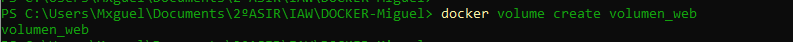

**volumen_web**

```bash
docker volume create volumen_web
```
  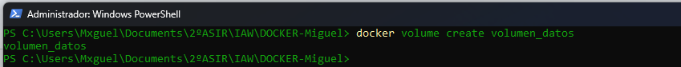

## 2. Una vez creados estos contenedores:

**Arrancar un contenedor llamado c1 sobre la imagen php:7.4-apache que monte el volumen_web en la ruta /var/www/html**

```bash
docker run -d --name c1 -v volumen_web:/var/www/html php:7.4-apache
```

  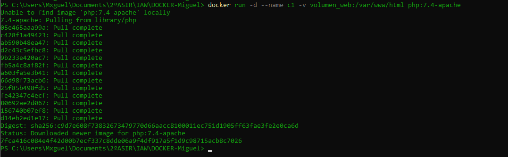

**Arrancar un contenedor llamado c2 sobre la imagen mariadb que monte el volumen_datos en la ruta /var/lib/mysql y cuya contraseña de root sea admin.**

```bash
docker run -d --name c2 -v volumen_datos:/var/lib/mysql -e MARIADB_ROOT_PASSWORD=admin mariadb
```

  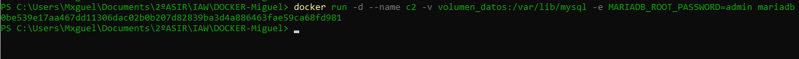

Comprobamos los contenedores:

```bash
docker ps -a
```
  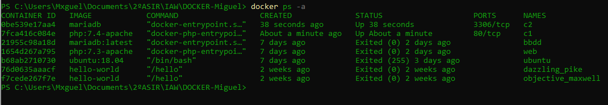

## 3.- Parar y borrar el contenedor c2 y tras ello borrar el volumen volumen_datos.

### 1. Parar el contenedor c2

```bash
docker stop c2
```

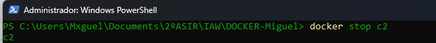

### 2. Borrar el contenedor c2

```bash
docker rm c2
```

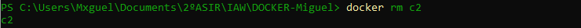

### 3. Borrar el volumen volumen_datos

```bash
docker volume rm volumen_datos
```

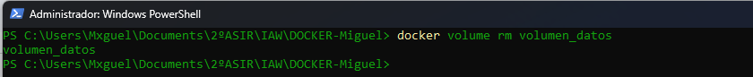

### 4. Comprobación final

```bash
docker ps -a
```

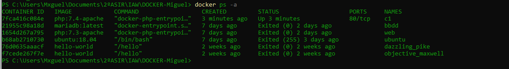

```bash
docker volume ls
```

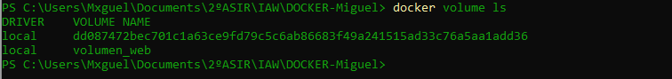

---

# Tarea 4.3

## 1. Crea una carpeta llamada saludo y dentro de ella crea un fichero llamado index.html con el siguiente contenido:

`<h1>HOLA SOY XXXXXX</h1>`

Deberás sustituir ese XXXXX por tu nombre.

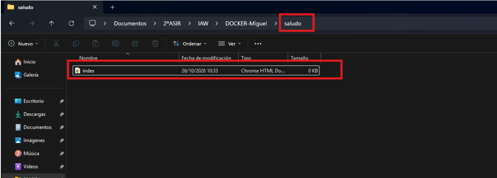

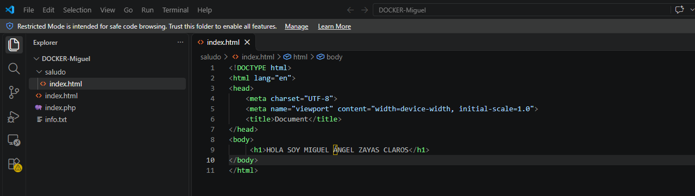

## 2. Una vez hecho esto arrancar dos contenedores basados en la imagen php:7.4-apache que hagan un bind mount de la carpeta saludo en la carpeta /var/www/html del contenedor.

```bash
docker run -d --name c1 -p 8181:80 -v "${PWD}\saludo:/var/www/html" php:7.4-apache
```

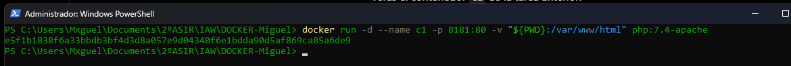

```bash
docker run -d --name c2 -p 8282:80 -v "${PWD}\saludo:/var/www/html" php:7.4-apache
```

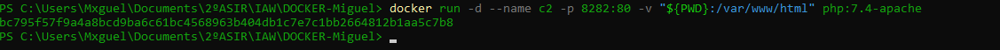

Comprobar que funcionan:

```bash
docker ps
```

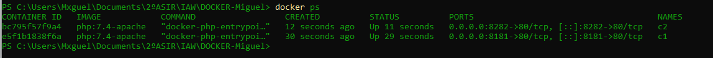

Comprobamos desde el navegador:

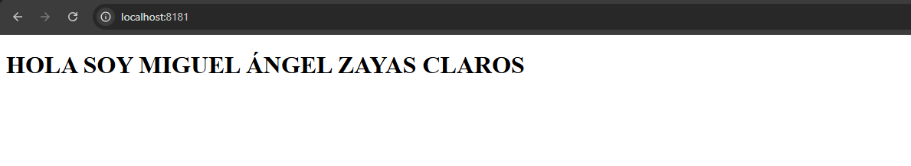

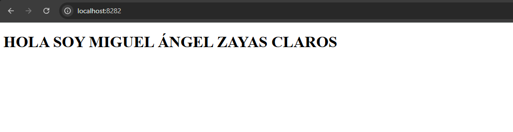

---

# Tarea 4.4

Creamos la carpeta y el archivo

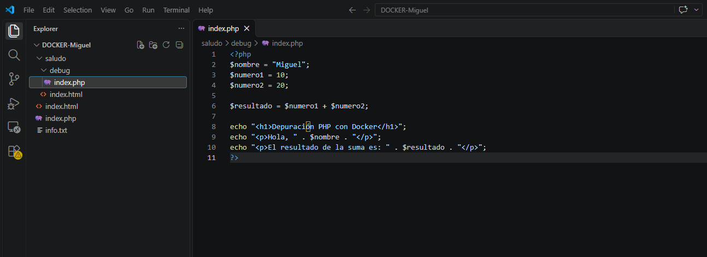

Creamos Dockerfile:

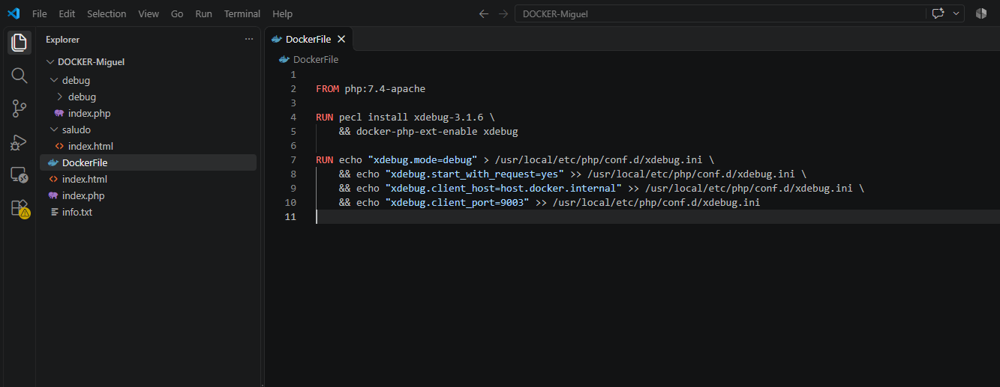

Construimos la imagen:

```bash
docker build -t php-debug
```

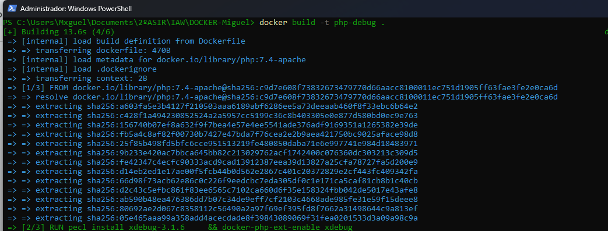

Arrancamos el contenedor:

```bash
docker run -d --name debugPHP -p 8585:80 -p 9003:9003 -v "${PWD}\debug:/var/www/html" php-debug
```

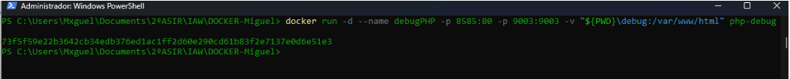

Comprobamos desde terminal:

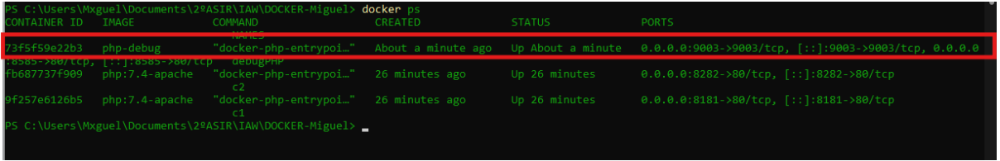

Comprobamos desde navegador:

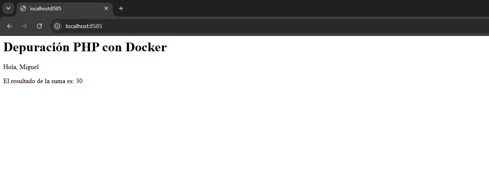

Vemos el bind mount:

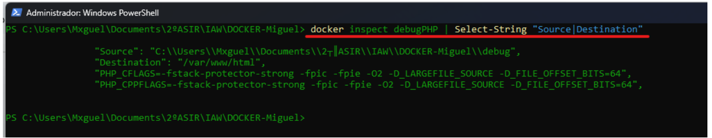
